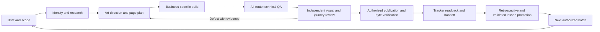
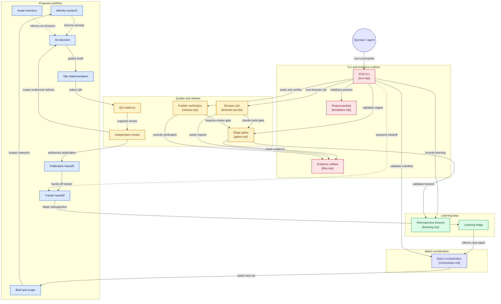

# Proposal ICM

A repeatable operating system for distinctive local-business website proposals. It turns research, art direction, implementation, visual review, publication and tracker handoff into bounded stages with evidence. It is designed to catch the failures that previously required repeated polish passes. No process can guarantee taste or a perfect first draft; this one fails closed when required evidence is missing.

**Start with [AGENTS.md](AGENTS.md) and the [context router](.icm/INDEX.md).** Read [the architecture](docs/architecture.md) for its trust/context layers. For a batch, use [the orchestrator prompt](prompts/orchestrator.md). Do not ask workers to read the entire repo.

## What this system delivers

- Business-specific research and a real existing-site inventory, including unknowns and conflicts.
- A deliberate visual concept, authentic asset inventory, plain copy, page-by-page content and customer journeys.
- A builder/reviewer separation, route-wide responsive checks, meaningful interaction tests and screenshot review.
- Reviewed-build hashing, public-file allowlists and stable/immutable deployment verification.
- Stable-ID tracker write plans that preserve outreach history and human corrections.
- Batch isolation, pinned instructions, durable state and explicit handoffs so a fresh agent can continue.
- Required [recursive learning](docs/learning.md): evidence-based retrospectives, tested lesson promotion and preloading adopted lessons into the next run.

There is no reusable homepage template, universal color palette, forced framework or default animation package. Reuse tested infrastructure; author each site's experience.

## Quick start

Node 22+ is required. Install the versioned CLI from npm:

```sh
npm install --global proposal-icm@1.0.0
proposal-icm --version
proposal-icm root
proposal-icm init ../private-proposals/CC-EXAMPLE
```

`root` prints the installed instruction directory. Give your agent that directory's `AGENTS.md` and `.icm/INDEX.md`; the npm command provides gates and evidence tools, not an autonomous website generator. Pin the package version in each assignment. For browser QA, install its matching Chromium with `npx --package=proposal-icm@1.0.0 playwright install chromium`, or set `PLAYWRIGHT_CHANNEL=chrome` to use installed Chrome. Installing the CLI does not install a browser or run lifecycle scripts.

For architecture development, regression tests and lesson promotion, use a source clone:

```sh
npm ci
npx playwright install chromium
npm run check
npm test
node bin/icm.mjs init ../private-proposals/CC-EXAMPLE
node bin/icm.mjs status ../private-proposals/CC-EXAMPLE
```

`init` creates unapproved, empty evidence packets, not a business website. Fill `project.json` with the verified identity, exact assignment, instruction commit and scoped authority. Read the relevant stage context. Validate a stage before advancing:

```sh
node bin/icm.mjs gate ../private-proposals/CC-EXAMPLE research
node bin/icm.mjs advance ../private-proposals/CC-EXAMPLE research
```

The gate checks that stage and its prerequisites; it returns nonzero on failure. `advance` writes a new state event only after the gate passes. `status` is observational and does not authorize any action. See [artifact contracts](docs/contracts.md) and [commands](docs/commands.md).

Installed instructions are a read-only version snapshot. When promoting a proven lesson, set `ICM_MAINTAINER_REPO` to the official source clone; promotion still requires an actual reviewed commit and regression evidence. Read [package installation and releases](docs/package-release.md) for install verification and maintainer steps. No additional reuse license is granted by this initial distribution (`UNLICENSED`).

## The delivery path



The agent may iterate internally before returning a site. A score is a review aid, not proof of beauty. Public launch and outreach remain separate actions with separate authority.

Every outcome, including a block/failure, gets a private learning packet and root review. The next batch loads adopted generic lessons. Proven changes are promoted after a wave; pinned instructions are not rewritten under running workers. See [the learning stage](stages/09-learn/CONTEXT.md).

## Architecture at a glance

[](https://gitdiagram.com/ksksrbiz-arch/proposal-icm/video)

The diagram below shows how the operator, the CLI, the evidence runtime and the nine stages connect. It was generated by [GitDiagram](https://gitdiagram.com/ksksrbiz-arch/proposal-icm) (see also its [interactive version](https://gitdiagram.com/ksksrbiz-arch/proposal-icm) and [one-minute video tour](https://gitdiagram.com/ksksrbiz-arch/proposal-icm/video)) from the file tree, this README and a sample of source files, last updated 2026-11-07. It is an AI-made overview: some stage nodes are inferred from directory names and the documented workflow rather than sampled code, so check details against the source and [the architecture doc](docs/architecture.md).



Component map:

| Group | Component | Location |
| --- | --- | --- |
| Proposal workflow | Brief and scope | [`stages/01-brief`](stages/01-brief/CONTEXT.md) |
| Proposal workflow | Identity research | [`stages/02-research`](stages/02-research/CONTEXT.md) |
| Proposal workflow | Art direction and asset inventory | [`stages/03-design`](stages/03-design/CONTEXT.md) |
| Proposal workflow | Site implementation | [`stages/04-build`](stages/04-build/CONTEXT.md) |
| Quality and release | QA evidence | [`stages/05-qa`](stages/05-qa/CONTEXT.md) |
| Quality and release | Independent review | [`stages/06-review`](stages/06-review/CONTEXT.md) |
| Proposal workflow | Publication handoff | [`stages/07-publish`](stages/07-publish/CONTEXT.md) |
| Proposal workflow | Tracker handoff | [`stages/08-register`](stages/08-register/CONTEXT.md) |
| Learning loop | Learning stage | [`stages/09-learn`](stages/09-learn/CONTEXT.md) |
| Quality and release | Stage gates | [`lib/gates.mjs`](lib/gates.mjs) |
| Quality and release | Browser QA | [`lib/browser-qa.mjs`](lib/browser-qa.mjs) |
| Quality and release | Publish verification | [`lib/release.mjs`](lib/release.mjs) |
| Learning loop | Retrospective lessons | [`lib/learning.mjs`](lib/learning.mjs) |
| CLI and evidence runtime | ICM CLI | [`bin/icm.mjs`](bin/icm.mjs) |
| CLI and evidence runtime | Project packets | [`lib/templates.mjs`](lib/templates.mjs) |
| CLI and evidence runtime | Evidence utilities | [`lib/files.mjs`](lib/files.mjs) |
| Batch coordination | Batch orchestration | [`prompts/orchestrator.md`](prompts/orchestrator.md) |

## Use with batch agents

Follow [the first-run guide](docs/first-run.md) when starting the next wave. A structural batch manifest is in [templates/batch.json](templates/batch.json), and the private handoff outline is in [templates/HANDOFF.md](templates/HANDOFF.md).

Give the root agent a private batch manifest matching `schemas/batch.schema.json`, the allowed lead IDs, the selected scope and the exact user authorization. The root reads the live tracker, assigns one business per worker, compares concepts across the wave, reviews every page, publishes approved bytes if authorized, and owns shared-sheet writes. Workers own only their assigned folders. See [batch protocol](docs/batch.md).

Suggested invocation:

> Use proposal-ICM at commit `<SHA>`. Build the following lead IDs from the shared tracker using a separate worker per business. Follow AGENTS.md and .icm/INDEX.md. Create private evidence packets, audit existing sites, exceed their useful core-page coverage, and pass independent mobile/desktop review. Publish to Cloudflare and update the tracker only if authorized below. Do not send outreach. Scope: `<lead IDs, first-site/redesign/refine, authority>`.

## Quality bar

See [design standard](docs/design-standard.md), [case-study lessons](reference/lessons.md) and [release checklist](docs/release.md). Examples reference prior public proposals as study material, not current fact sources or promises that an owner approved them. Never reuse another company's identity or photos.

## Tooling boundaries

`browser-qa` captures route-wide evidence; project-specific flow tests remain required. `seal` hashes only allowlisted public files and records the reviewed contract fingerprint. `verify-public` compares those bytes on both deployment URLs. A release still requires a reviewer to inspect screenshots and the actual customer journeys.

The kit never reads credentials, contacts prospects, mutates the shared sheet, creates cloud resources or deploys on its own. It produces reviewed evidence and write plans for an authorized operator to apply with the connected tools. Real project data is ignored by Git and is not part of this public repository. See [validation scope](docs/validation.md) and [the improvement loop](docs/improving-the-system.md).
